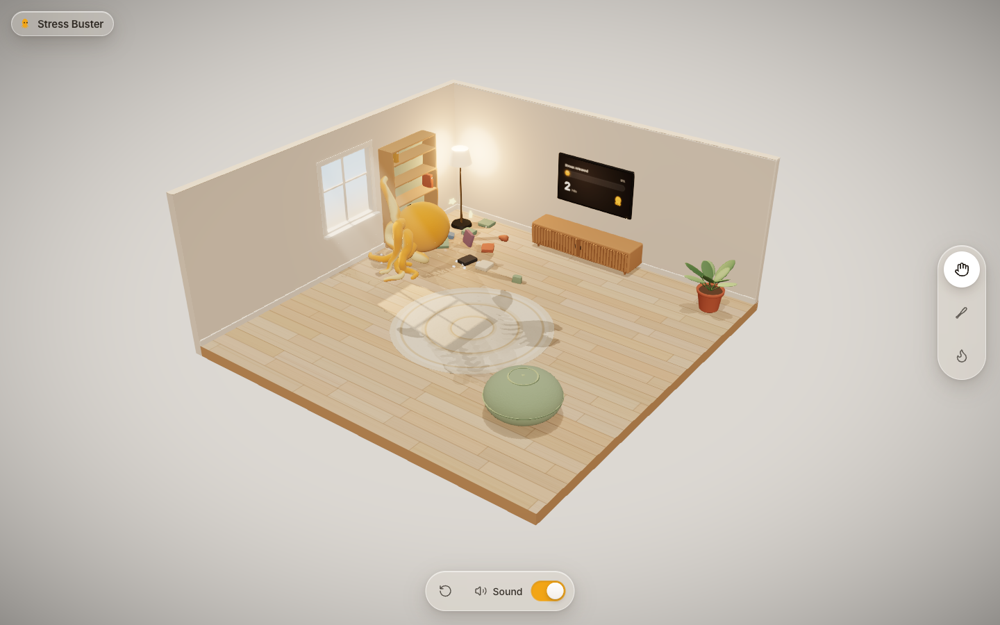

# Stress Buster

**Play it: https://anthonyfernandes06.github.io/Stress-Buster-Plushy/**



A small 3D stress-relief toy: a velvety yellow plush octopus in a cozy room that you can grab, fling, punch, bat across the room and set on fire. Cartoon violence only: it squashes, puffs fluff, gets dizzy, goes sooty, and always recovers.

Built with Vite, React, TypeScript, @react-three/fiber, drei, Rapier physics (@react-three/rapier), @react-three/postprocessing, zustand and the Web Audio API. Every model, texture and sound is generated in code, so the project ships with no binary assets.

## Run it

```bash
npm install
npm run dev
```

Vite prints the local URL (default `http://localhost:5173`). In the Claude desktop app, `.claude/launch.json` starts it on port 5180, or on 5181 for the production preview.

## Build and deploy

```bash
npm run build      # type-checks, then writes a static site to dist/
npm run preview    # serves dist/ locally
```

`dist/` is a plain static site, and its asset URLs are relative, so it works at a domain root or under a sub-path.

- **GitHub Pages** (how this repo is hosted): run `npm run deploy`. It builds the site and force-pushes `dist/` to the `gh-pages` branch, which Pages serves. In the repo settings, Pages must be set to "Deploy from a branch" using `gh-pages` / root.
- **Vercel**: framework preset "Vite", build command `npm run build`, output `dist`.
- **Netlify**: build command `npm run build`, publish directory `dist`.

The production bundle is about 1.3 MB gzipped. That includes Rapier's embedded WASM, which is most of it.

## Controls

| Input | Action |
|---|---|
| Drag the octopus (Hand) | Lift, move, stretch tentacles |
| Flick and release (Hand) | Throw |
| Quick tap on the octopus (Hand) | Punch |
| Swipe or drag (Bat) | Swing in that direction (a tap does a default swing) |
| Press and hold (Lighter) | Ignite the flame; hold it near the octopus to burn it |
| `1` `2` `3` | Hand, Bat, Lighter |
| `R` | Reset the room |
| `M` | Mute or unmute |
| `Esc` | Release the held octopus |

## Project layout

```
src/
  config.ts               every tuning number (see below)
  App.tsx                 Canvas + glass UI overlay, global keyboard shortcuts
  state/store.ts          zustand: tool, mute, hits, stress meter, plushy state, reset token
  state/runtime.ts        per-frame mutable state shared by systems (plushy handle, fx emitters, shake, hit-stop)
  scene/
    Scene.tsx             lights, environment, physics world, contact shadows, postprocessing
    CameraRig.tsx         fits the room to any viewport, pointer parallax, camera shake
    Room.tsx              floor, walls (left wall has a real window opening), invisible colliders
    props/                MediaConsole, Tv (live meter screen), Bookshelf (+ books), Pouf, Rug, Lamp, Plant, Window
    plushy/
      Plushy.tsx          ragdoll (head + 8 tentacles x 8 segments), joints, reactions, fire, idle charm
      Tentacle.tsx        tapered two-tone tube rebuilt in place every frame
      PlushyMaterial.ts   velvet MeshPhysicalMaterial + injected char / heat / hit-flash terms
      Eyes.tsx            expressions: blink, > <, X X, dizzy spirals, panic, wide
      headShape.ts        head surface function (mesh, eyes and heat lookups all use it)
      layout.ts           rest pose of the octopus
    tools/                Tools (pointer routing), HandTool, BatTool, LighterTool
    fx/                   pooled particles (fluff, fire, smoke, sparks), impact rings, camera shake
  audio/SoundManager.ts   procedural Web Audio sounds behind play('thud', { intensity, pitch })
  ui/                     Wordmark, ToolDock, BottomBar, IntroCard, HintToast, Loader, ui.css
```

## Tuning the feel (`src/config.ts`)

| Section | What it controls |
|---|---|
| `PHYSICS` | gravity, fixed timestep, solver iterations |
| `PLUSHY` | head size and mass, tentacle radii, segment mass, rest pose (`restPitch`, `restCurl`), char recovery time, held gravity scale |
| `PLUSHY.joints` | swing limits (radians) and motor stiffness for root, middle and tip joints, plus joint damping. Higher stiffness gives a firmer plush; lower gives a limper one. |
| `PLUSHY.material` | friction, restitution, linear and angular damping |
| `IMPACT` | light/heavy thresholds (m/s), per-body debounce, hit-stop length |
| `HAND` | grab spring stiffness and damping, carry heights, throw window, speed clamp, punch impulse |
| `POUF_BOUNCE` | the extra launch when the octopus lands on the pouf |
| `BAT` | bat size, sweep angle, swing speed range, launch scale, aim assist, cooldown |
| `FIRE` | heat radius and rate, time to ignite, spread delay, burn duration, flailing |
| `METER` | how fast each kind of hit fills the TV meter |
| `PARTICLES` | pool sizes per particle system |

## Replacing synthesized sounds

`src/audio/SoundManager.ts` exposes `sound.play(name, { intensity, pitch, muffled })`. To use recordings:

1. Put files in `public/sfx/` (for example `public/sfx/thud.mp3`).
2. Add them to `SAMPLE_FILES` at the top of `SoundManager.ts`, for example `{ thud: 'sfx/thud.mp3', crackle: 'sfx/crackle.mp3' }`. Paths are relative to the site root, so they also work on GitHub Pages.

A listed sample replaces the synthesized version, with `intensity` mapped to gain and `pitch` to playback rate. A `crackle` sample is played as the burning loop. Anything not listed stays synthesized.

## Replacing procedural assets with models

Each prop is a self-contained component. Visual meshes sit next to their physics bodies but are separate from them. To swap in a GLB, load it with drei's `useGLTF` and replace the `<mesh>` children inside the component, leaving the `RigidBody` and colliders as they are. Gameplay code only talks to props through `runtime.props.*` (for example `tv.glitch()` or `pouf.squash()`), so it doesn't need to change.

The octopus is the exception. Its tentacles are driven by the physics chain. A skinned GLB would need one bone per segment, with each bone's transform copied from its segment body every frame, in the same place `TentacleTube.update` runs today.

## Known limitations

- **Joint limits use Rapier internals.** Rapier's JS API has no limits or motors for spherical joints, so `Plushy.tsx` sets per-axis limits and motors through the joint's raw set (`jointSetLimits`, `jointConfigureMotorPosition`). It works with `@dimforge/rapier3d-compat` 0.19 but could break on a Rapier upgrade.
- **Rapier init warning is patched.** rapier3d-compat 0.19 initialises its WASM with a deprecated call that logs a console warning. A tiny Vite plugin in `vite.config.ts` rewrites that call.
- **three.js is pinned to 0.182.** From r183 three deprecates `THREE.Clock`, which React Three Fiber 9 still uses, and that logs a warning on every load.
- **Hit-stop slows everything.** It scales every frame delta (physics, particles and animation together), which is the intended "freeze frame" feel.
- **The lighter only targets the octopus and the floor.** Furniture tops are not raycast.
- **Fire never spreads to props.** This is by design.
- **The optional ±15° drag-orbit is not implemented.** The camera is fixed apart from pointer parallax and shake.
- **The room is small on portrait phones.** It is fit to the screen width.
- **Tentacle tubes are rebuilt on the CPU every frame.** About 5k vertices in total, using reused buffers.

## Suggested next steps

- Record real foley (plush squeaks, wood thwack, a crackle loop) and drop it into `SAMPLE_FILES`.
- Add a GLB plushy with skinned tentacles for a softer, sculpted look.
- Add a closer portrait camera on phones, or a short pinch-free zoom.
- Move the tentacle tube deformation to the GPU (bone texture or vertex shader).
- Add a gentle drag-orbit (±15°) with a reset-view button.
- Have the TV react to more events (a "nice throw!" for long flights, a fire emoji while burning).
